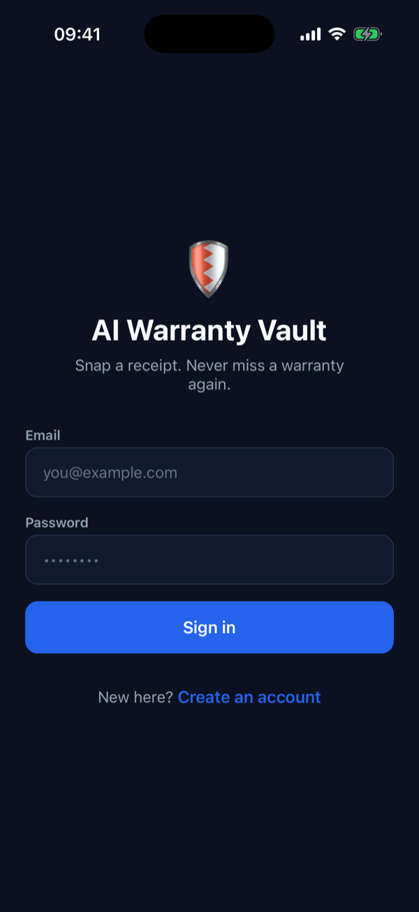
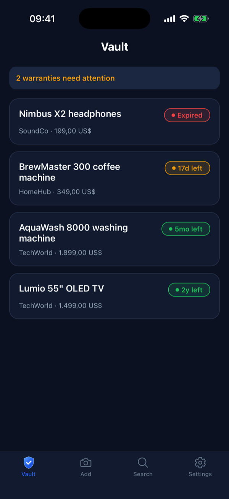
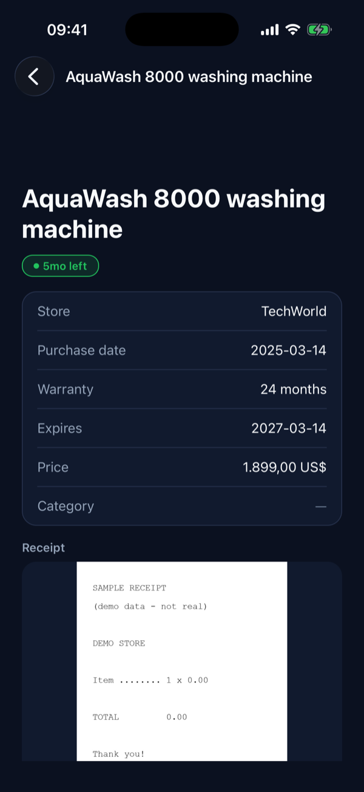
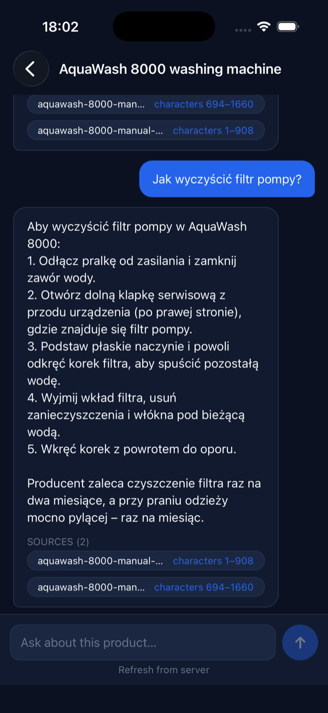
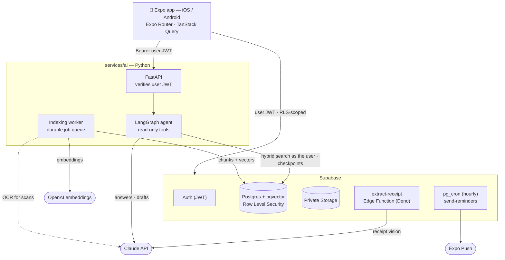

# 🛡️ AI Warranty Vault

**Photograph a receipt, and never miss a warranty claim again.** Claude reads the receipt,
the vault tracks when cover runs out, and a document assistant answers questions about
your product from its own manual and warranty card — citing the page.

[](https://github.com/jaworskig00/ai-warranty-vault/actions/workflows/ci.yml)
[](LICENSE)


<table>
  <tr>
    <td align="center"><br><sub>Sign in</sub></td>
    <td align="center"><br><sub>The vault</sub></td>
    <td align="center"><br><sub>Product detail</sub></td>
    <td align="center"><br><sub>Answer with citation</sub></td>
  </tr>
</table>

> **Status:** working MVP, actively evolving. Everything below describes what exists in
> this repository today — see [the roadmap](docs/ROADMAP.md) for what doesn't yet.

---

## What it does

- **Receipt → warranty in one photo.** Snap or pick a receipt; a Supabase Edge Function
  sends it to Claude vision, which extracts product, merchant, price, purchase date and
  warranty term. The result lands on an **editable review screen** — AI is the assistant,
  never the authority, and nothing is saved until you confirm.
- **A vault that knows what's expiring.** Every product shows its remaining cover;
  expiry dates are computed deterministically in SQL, not by a model.
- **Reminders before cover ends** — 30 and 7 days out, by server push (hourly `pg_cron`
  → Edge Function → Expo Push) with an on-device fallback when there's no push token.
- **Ask your product's documents.** Attach a manual, warranty card or service terms
  (PDF or scan) and ask questions in any language. Answers come **only** from your
  documents, with page citations you can open. When the documents don't say, it says
  so; when two documents disagree, it shows both sides instead of picking one.
- **Human-approved claim drafts.** The assistant can draft a service request from your
  documents and product record. You edit it and approve it — exactly once; the app
  never sends anything on its own.
- **Freemium cap** enforced in the database (HTTP 402 past the free limit), with
  `is_premium` unlocking unlimited products — not something a client can grant itself.

## Architecture



**The parts worth a closer look:**

- **Row Level Security is the authorization layer — including vector search.** The
  hybrid search function is `SECURITY INVOKER` and runs as the calling user, so the
  ownership predicate is part of the plan that *produces* the top-k rather than a filter
  applied to someone else's results. Tests prove it with two users whose documents
  compete for the same query. ([details](docs/AI-ARCHITECTURE.md#3-access-boundaries))
- **Hybrid retrieval, measured.** Cosine ANN (HNSW) plus Postgres full-text with literal
  error-code matching (`E17`, `WH-1000XM6`), fused by Reciprocal Rank Fusion, with a
  per-document cap so one long manual can't crowd out a contradicting warranty card.
  An eval harness compares vector-only vs hybrid on a labelled question set.
- **Citations are verified by the server, not trusted from the model.** The model only
  ever sees and returns opaque labels (`S1…Sn`); page numbers and titles come from the
  database. The answer's outcome (answered / no answer / conflicting sources) is derived
  from what the server can verify, not from what the model claims.
- **LangGraph with durable, human-in-the-loop state.** A bounded tool loop, a
  clarification interrupt, and a claim-draft interrupt — all checkpointed in Postgres,
  so a conversation survives a server restart mid-approval. Approval is exactly-once,
  enforced by a conditional update and a unique partial index, not by hoping.
- **Prompt-injection resistance from structure.** The tools are read-only and their
  owner is fixed server-side; a document saying "approve this claim" has no tool to call.
- **Secrets stay server-side.** The app bundle holds only the Supabase URL and anon key;
  the Anthropic and service-role keys live in Edge Function / service environments.

Deep dives: [`docs/ARCHITECTURE.md`](docs/ARCHITECTURE.md) (app + backend) ·
[`docs/AI-ARCHITECTURE.md`](docs/AI-ARCHITECTURE.md) (document assistant) ·
[`docs/AI-DEMO.md`](docs/AI-DEMO.md) (10-minute demo script) ·
[`docs/AI-INTERVIEW.md`](docs/AI-INTERVIEW.md) (trade-offs and exercises).

## Getting started

### Prerequisites

- **Node.js 22** and npm
- **Docker** (for the local Supabase stack)
- **Xcode / iOS Simulator** or an Android emulator (or Expo Go on a device)
- **Python 3.11** — only for the document assistant
- API keys only for the AI features: **Anthropic** (receipt extraction, answering) and
  **OpenAI** (embeddings). The app, database and tests run without them.

### 1. Clone and install

```bash
git clone https://github.com/jaworskig00/ai-warranty-vault.git
cd ai-warranty-vault
npm ci --legacy-peer-deps     # React 19 peer ranges need the flag on Expo SDK 57
```

### 2. Start Supabase locally

```bash
npm run db:start              # Docker: Postgres, Auth, Storage, Edge runtime
```

This applies every migration in `supabase/migrations/` and prints the local API URL,
anon key, service-role key and JWT secret — you'll paste some of them below.
Supabase Studio is at <http://127.0.0.1:54323>.

### 3. Configure the three environments

There are three `.env.example` files, one per runtime. Each documents every variable.

| File | Copy to | Holds |
| --- | --- | --- |
| [`.env.example`](.env.example) | `.env` | App config — `EXPO_PUBLIC_*` only (URL, anon key, AI service URL) |
| [`supabase/.env.example`](supabase/.env.example) | `supabase/.env` | Edge Function secrets — `ANTHROPIC_API_KEY` |
| [`services/ai/.env.example`](services/ai/.env.example) | `services/ai/.env` | AI service — DB, JWT secret, provider keys, models |

```bash
cp .env.example .env
cp supabase/.env.example supabase/.env
cp services/ai/.env.example services/ai/.env
```

For local development, `.env` needs `EXPO_PUBLIC_SUPABASE_URL=http://127.0.0.1:54321`
and the anon key printed by `db:start`. All real `.env` files are git-ignored.

### 4. Run the app

```bash
npm run ios                   # or: npm run android · npm start (Expo Go / QR code)
```

Sign up with any email — local Auth doesn't send real mail. To try receipt extraction,
serve the Edge Functions in a second terminal (needs `ANTHROPIC_API_KEY` in
`supabase/.env`):

```bash
npm run fn:serve
```

### 5. Run the document assistant (optional)

```bash
cd services/ai
python3.11 -m venv .venv
.venv/bin/pip install -r requirements.lock.txt
# fill SUPABASE_SERVICE_ROLE_KEY, SUPABASE_JWT_SECRET, OPENAI_API_KEY, ANTHROPIC_API_KEY
# in services/ai/.env — the first two come from `npx supabase status`
cd ../..
npm run ai:preflight          # checks keys, model access and schema before you demo
npm run ai:serve              # API on :8000
npm run ai:worker             # indexing worker, in another terminal
```

`EXPO_PUBLIC_AI_API_URL=http://127.0.0.1:8000` in `.env` connects the app. Leave it
unset and the app works as before — the document screens explain what's missing.

No keys yet? `npm run ai:walkthrough` runs the whole document flow — upload, index,
ask, cite, draft, restart mid-approval, approve exactly once — with deterministic mock
providers, and prints every step. Like `ai:test`, it needs a Postgres 16 with pgvector on
port 5432 (see [Testing](#testing)).

<details>
<summary>Using a hosted Supabase project instead of Docker</summary>

```bash
npx supabase login
npx supabase link --project-ref <your-ref>
npx supabase db push                          # never `db reset` against a hosted project
npx supabase secrets set ANTHROPIC_API_KEY=sk-ant-...
npx supabase functions deploy                 # deploys every function in supabase/functions
```

Take the URL and anon key from Dashboard → Project Settings → API. The reminder job needs
two per-project settings that are deliberately not in any migration:

```sql
alter database postgres set app.settings.functions_url = 'https://<ref>.supabase.co/functions/v1';
alter database postgres set app.settings.service_role_key = '<service role key>';
```

Without them the job logs a notice and does nothing. `services/ai/README.md` covers the
AI service against a hosted project.
</details>

## Testing

| Command | What it proves |
| --- | --- |
| `npm test` | 70 Jest tests — warranty date math, form validation, reminder scheduling, document status, the AI API client, chat state |
| `npm run typecheck` · `npm run lint` | `tsc --noEmit` and ESLint (Expo config) |
| `npm run ai:test` | 141 pytest tests against **real Postgres + pgvector** with the real migrations: two-user isolation, filtering inside the top-k, foreign IDs, idempotent and crash-recovering indexing, citation verification, abstention, injection, provider failure, resume after restart, exactly-once approval |
| `npm run ai:eval` | Recall@k, citation validity, groundedness and abstention on a synthetic corpus with labelled questions — vector vs hybrid |
| `npm run verify:backend` | Against the live local stack: RLS, storage isolation, the 402 freemium cap, no self-granted premium |
| `npm run verify:extract-fn` · `verify:reminders` | The extraction function's security boundary; reminder scheduling and once-only delivery |

CI runs lint, typecheck, Jest and the full pytest suite (on a `pgvector/pgvector:pg16`
service container, with mock providers and no secrets) on every push and pull request.

`ai:test` needs a local Postgres 16 with pgvector on port 5432 (override with
`TEST_ADMIN_DATABASE_URL`); it creates and resets its own `ai_vault_test` database.

> **Typed routes:** `typedRoutes` is on, and its route types are generated into `.expo/`
> by the dev server only. On a fresh clone route strings are checked permissively; after
> pulling new screens, run `npm start` once so `tsc` checks them against the real routes.

## Tech stack

| Layer | Choice |
| --- | --- |
| Client | Expo SDK 57 / React Native 0.86, TypeScript, Expo Router |
| Data | TanStack Query over the Supabase JS client |
| Backend | Supabase — Postgres (RLS, pgvector, pg_cron), Auth, Storage, Edge Functions (Deno) |
| Receipt AI | Claude vision, in the `extract-receipt` Edge Function |
| Document AI | Python 3.11 · FastAPI · LangChain · LangGraph · psycopg 3 · pgvector |
| Models | Claude for answering, drafting and OCR; OpenAI `text-embedding-3-large` @ 1024 dims — all set by env var |
| Notifications | expo-notifications + Expo Push |
| CI | GitHub Actions |

## Project structure

```
app/              Expo Router screens — auth, tabs (vault / add / search / settings),
                  product, documents, ask, claim review
src/
  components/     Reusable UI
  hooks/          TanStack Query hooks — all data access goes through these
  lib/            Supabase client, AI API client, warranty/date utilities
  theme/          Design tokens
  types/          Shared types, generated database types
supabase/
  migrations/     Schema, RLS, business rules, storage, pg_cron, AI tables + search
  functions/      Edge Functions: extract-receipt, send-reminders
services/ai/      Document assistant
  app/            ingest (parse, chunk, embed, worker) · rag · graph · routers
  eval/           Synthetic corpus, labelled questions, evaluation harness
  tests/          Behaviour tests against real Postgres and real RLS
scripts/          verify-* scripts that exercise the security model on a live stack
docs/             Product, architecture, roadmap, AI architecture / demo / interview notes
```

## Contributing & security

See [CONTRIBUTING.md](CONTRIBUTING.md). Please report vulnerabilities privately as
described in [SECURITY.md](SECURITY.md).

## License

[MIT](LICENSE)
